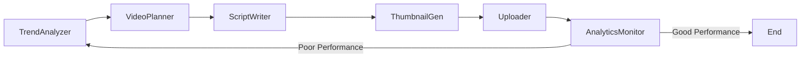

# 🎬 YouTube Content Strategist

A multi-agent YouTube content creation pipeline powered by [LangGraph](https://github.com/langchain-ai/langgraph) and local open-source LLMs via [Ollama](https://ollama.com). From trend discovery to thumbnail generation and simulated analytics — all running locally with no API costs.

---

## 🌟 Features

- **🤖 Multi-Agent Architecture** – Six specialized agents working in harmony
- **🔄 Feedback Loop** – Automatic performance monitoring and content iteration
- **🏠 100% Local** – Uses Ollama for LLM inference (no API keys or costs!)
- **🎨 Complete Pipeline** – From trend analysis to thumbnail creation
- **📊 Analytics Simulation** – Performance tracking with CTR and engagement metrics
- **🔧 Modular Design** – Easy to extend, modify, or plug into existing tools

---

## 📋 Agent Pipeline



### Agent Roles

1. **TrendAnalyzer** 🔍

   - Finds trending topics within a given niche
   - Uses LLMs to evaluate topic relevance and competitiveness

2. **VideoPlanner** 📋

   - Crafts compelling video ideas and titles
   - Identifies target audience and intent

3. **ScriptWriter** ✍️

   - Writes high-retention video scripts
   - Includes hooks, storytelling, and CTAs

4. **ThumbnailGenerator** 🎨

   - Creates custom thumbnails using PIL
   - Follows niche-specific design trends

5. **Uploader** 📤

   - Simulates video upload process
   - Stores metadata (title, description, tags)

6. **AnalyticsMonitor** 📊
   - Simulates video performance analytics
   - Calculates a performance score
   - Triggers feedback loop if underperforming

---

## 🚀 Quick Start

### ✅ Prerequisites

- Python 3.10+
- [Poetry](https://python-poetry.org/docs/#installation)
- [Ollama](https://ollama.com) installed and running locally  
  _(This project defaults to using `mistral:7b`, but supports any local model you load with Ollama.)_

---

### 📦 Installation

```bash
# Clone the repository
git clone <repository-url>
cd youtube-content-strategist

# Install dependencies
poetry install

# Pull a supported model (if not already available)
ollama pull mistral:7b
```

---

### 🧪 Basic Usage

```bash
# Activate the Poetry virtual environment
poetry shell

# Run the pipeline for a specific niche (e.g., tech)
python -m youtube_strategist.main tech
```

### 🛠️ Custom Options

```bash
python -m youtube_strategist.main gaming \
  --model mistral:7b \
  --max-iterations 3 \
  --performance-threshold 0.6 \
  --save-state
```

---

### ⚙️ Command Line Arguments

```text
positional arguments:
  niche                      Content niche (e.g., tech, gaming, education, lifestyle)

optional arguments:
  --model MODEL              Ollama model to use (default: mistral:7b)
  --max-iterations N         Maximum feedback loop cycles (default: 3)
  --performance-threshold X  Minimum acceptable performance score (default: 0.6)
  --output-dir DIR           Output directory (default: output)
  --log-level LEVEL          Logging level (default: INFO)
  --save-state               Save final agent state to JSON file
```

---

## 🧱 Project Structure

```
youtube-content-strategist/
├── src/
│   └── youtube_strategist/
│       ├── __init__.py
│       ├── main.py              # CLI entry point
│       ├── graph.py             # LangGraph pipeline definition
│       ├── state.py             # Shared agent state model
│       ├── llm.py               # Ollama model interface
│       ├── utils.py             # Helper functions
│.      ├── output/
│       │.  ├── thumbnails/
│       │.  ├── uploads
│       │
│       └── agents/
│           ├── trend_analyzer.py
│           ├── video_planner.py
│           ├── script_writer.py
│           ├── thumbnail_gen.py
│           ├── uploader.py
│           └── analytics_monitor.py
├── README.md
├── pyproject.toml
├── poetry.lock
└── .gitignore
```

---

## 🤝 Contributing

Contributions are welcome! Feel free to open issues or submit pull requests to extend the pipeline, add new agent types, or support additional models.

---

## 📄 License

This project is licensed under the MIT License. See the [LICENSE](./LICENSE) file for details.

---

## 💡 Future Ideas

- Integrate with YouTube Data API for real uploads
- Add voiceover generation with TTS
- Support multilingual scripting
- Add agent for Community Post & Shorts generation
- Real-time trend scraping from Twitter, Reddit, etc.

---

## 🙋‍♀️ FAQ

**Q: Can I use this without Ollama?**  
A: The project is designed around Ollama for local inference. With minimal changes, it could be adapted for OpenAI, Hugging Face, or other providers.

**Q: Is it production-ready?**  
A: It’s a research-grade prototype — ideal for experimentation and customization.

---

Made with 🧠 + 🎨 + ❤️
